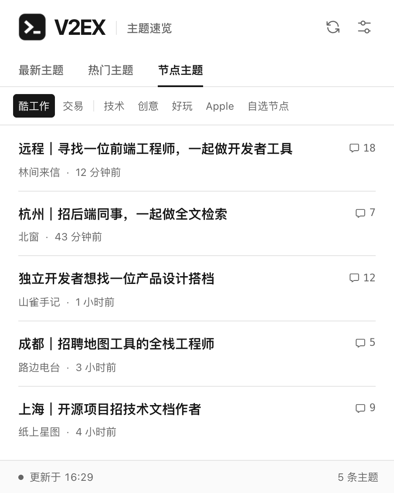

# V2EX 主题速览

在 Chrome 工具栏里浏览 V2EX 的最新主题、热门讨论和节点分类。点击标题会在新标签页打开原帖。读完再点扩展图标，可以接着看刚才的列表。

*扩展弹窗预览，图中使用示例数据。*

## 安装

适用于 Chrome 120 及以上版本。下载的扩展可以直接加载，无需构建。

1. 打开项目仓库，点击 **Code → Download ZIP**，将压缩包解压到准备长期保留的目录。使用 Git 也可以运行 `git clone https://github.com/shawncai/v2ex-extensions.git`。[GitHub 仓库](https://github.com/shawncai/v2ex-extensions)
2. 在 Chrome 地址栏输入 `chrome://extensions`，开启右上角的「开发者模式」。
3. 点击「加载已解压的扩展程序」，选中仓库里的 **`extension/`** 文件夹。打开该文件夹就能看到 `manifest.json`。
4. 点击工具栏上的拼图图标，固定「V2EX 主题速览」。点开扩展即可浏览公开主题。

## 可以看哪些列表

| 列表 | 公开模式（默认） | 设置个人令牌后 |
| --- | --- | --- |
| 最新主题 | 最近一批主题 | 全站最新主题，可翻页 |
| 热门主题 | 当前热门列表 | 同公开模式 |
| 节点主题中的六个分类 | 各分类的官方订阅 | 同公开模式 |
| 自选节点 | 指定节点最近一批主题 | 同一节点的主题，可翻页 |

- 「节点主题」默认打开**酷工作**，旁边是**交易**，也可以切换到**技术、创意、好玩、Apple**。六个分类与 V2EX 首页对应，例如「酷工作」同时收录招聘、求职和职场话题。
- 查看某个具体节点时，选择「自选节点」，输入该节点网址中 `/go/` 后的名称，例如 `python`。主题下方如有节点标签，也可以直接点击。
- 在同一次 Chrome 会话中重新打开弹窗，会恢复上次阅读的列表、页码和滚动位置。右上角的刷新按钮可随时重新读取当前页。
- Chrome 每三小时在后台检查最新主题、酷工作和交易的首页。当前列表有更新时，点页脚的「查看更新」即可切换到新版首页。如果正在读最新主题的后续页面，按钮会显示「查看首页更新」。电脑休眠期间错过的检查会在唤醒后执行。[Chrome 定时任务说明](https://developer.chrome.com/docs/extensions/reference/api/alarms#device_sleep)

## 启用翻页

1. 登录 V2EX，准备好自己的个人访问令牌。[V2EX 令牌管理](https://www.v2ex.com/settings/tokens)
2. 点击扩展右上角的「令牌设置」。可以直接将令牌粘贴到「或手动输入令牌」，也可以点击「选择配置文件」，导入含 `TOKEN=你的令牌` 一行的本地 `.env` 或 `.txt` 文件。在 macOS 文件选择器中，按 `⌘ + Shift + .` 可显示隐藏文件。
3. 点击「保存令牌」，看到「个人令牌」后回到弹窗。打开「最新主题」或「自选节点」，用页脚箭头翻页。

扩展仅在当前 Chrome 会话中保存令牌。重启浏览器或重新加载扩展后，需要再次导入或粘贴。也可以在设置页点击「切回公开模式」，清除扩展保存的令牌。

## 权限与数据

| 权限 | 用途 |
| --- | --- |
| `storage` | 在 `chrome.storage.session` 中暂存令牌、列表缓存和阅读位置 |
| `alarms` | 按三小时间隔检查三个列表的更新 |
| `https://edge.v2ex.com/*` | 读取 V2EX 的公开主题接口、分类 Atom 订阅和 API 2.0 |

扩展在本机读取所选配置文件，只提取 `TOKEN` 字段。令牌仅随 API 2.0 的请求发往 V2EX，放在 `Authorization` 请求头中。公开列表使用匿名请求。[V2EX API 2.0 文档](https://edge.v2ex.com/help/api)

## 更新扩展

使用 Git 安装的用户可以在仓库目录运行 `git pull --ff-only`。使用 ZIP 安装的用户可以重新下载、解压，将新版 `extension/` 的内容覆盖到原安装目录。然后打开 `chrome://extensions`，在「V2EX 主题速览」卡片上点击「重新加载」。如需翻页，重新保存个人令牌即可。
